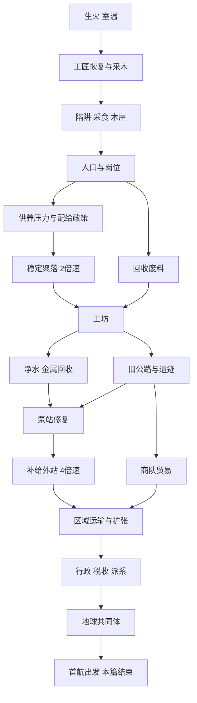

# 系统依赖与经济成长曲线

## 系统依赖

首个聚落至泵站和补给外站为当前实现范围。区域运输、领土政治、地球和太空是后续范围；原版 World/Space 源码留存不代表本作已实现这些系统。

## 资源人口模型

| 资源 | 获得 | 消耗 |
| --- | --- | --- |
| 木料 | 采木10/60秒，手推车后50/60秒；工匠2/10秒；采木工1/10秒 | 生火5、添火1、建筑、研究、事件 |
| 食物 | 采食6/60秒；每个陷阱2/90秒；猎人0.8/10秒 | 每居民基础0.12/10秒、旅途、救助 |
| 毛皮 | 每陷阱1/90秒；猎人0.3/10秒 | 交易和后续衣物 |
| 废料 | 2居民后搜集4/90秒；回收工0.5/10秒；遗迹 | 工坊、研究、设施 |
| 知识 | 研究成功后的永久标记 | 研究消耗材料和时间，知识不会用完 |
| 信任 | 接纳、公共规则、稳定供给 | 饥饿与压榨；影响迁入，可恢复 |

人口为可分工居民，主角与工匠不占木屋岗位，工匠提供基础燃料恢复路径。每间木屋4席，移民需要暖房、空位与存粮。缺粮不会继续自动招人。所有岗位每10模拟秒结算；先产出后口粮，无原料岗位停产，不出负库存。调整岗位不重置结算相位。持续饥饿降产、降信任，连续180秒才有人离开；补充食物逐步恢复。

## 建造与首段成长

| 建筑 | 成本 | 前提与结果 |
| --- | --- | --- |
| 陷阱 | 木10，每个递增10，最多5 | 工匠恢复；确定性食物和毛皮，避免随机掉落卡主线 |
| 手推车 | 木30 | 工匠恢复；采木量10→50，仍冷却60秒 |
| 木屋 | 木100，每间递增50，最多4 | 工匠恢复；每间4席 |
| 猎棚 | 木60、食物6 | 木屋；开放猎人 |
| 粮棚 | 木60 | 2居民；公共储备与稳定聚落条件 |
| 工坊 | 木100、废料12 | 稳定聚落；研究、回收工、旧公路 |
| 集水设施 | 木80、废料16 | 净水研究与泵站位置；供养余量提高 |
| 补给外站 | 木120、废料20、食物20 | 两项研究、修好泵站、8居民、集水设施；4倍速 |

2倍速永久解锁：至少4居民、猎棚、粮棚、配给已决定，木≥60且食物≥20连续60模拟秒。4倍速由补给外站建成解锁。解锁不自动切速，之后人口或库存回落不撤销。倍率统一影响火、室温、冷却、生产、人口、事件、研究与旅行；界面动画、存档网络请求不加速。

## 科技和政策

净水工艺：工坊，木20、废料10，120模拟秒；用于泵站修复。金属回收：工坊，木10、废料20，180秒；回收工效率提高。只允许一项试制同时进行。后续基础冶炼依赖矿点、燃料与炉体；电力依赖导线、涡轮与维护人才；区域标准件依赖钢铁与交通；行政教育依赖稳定盈余；轨道依赖全球产业链。恢复基础技术不互相永久排斥，发展路线通过投资先后、持续开支和机会成本区分。

至少2居民、食物低于16时提出配给；库存充足则居住60秒后同样提出，主线不依赖故意制造饥荒。均分口粮：正常消费与产出，首次信任+5；压缩口粮：消费×0.75、产出×0.9，首次信任−8；加厚口粮：消费×1.25、产出×1.1，首次信任+3。改议冷却120秒；每个政策的首次信任变化仅一次，不能切换刷分。

后续政策轴为工时、接纳、产权、代表制和公民资格，分别影响产能、伤病、迁入、税基、派系与外交。派系从职业和地区利益形成，开局不展示抽象派系表。

## 探索外交扩张

旧公路旅行有食物成本和真实等待，出发即扣费，保存剩余时间。交通站遗址是确定主线，带回地火交通证据与泵站路线。泵站需净水工艺与维修材料。重复遗址仅获得少量废料，不能刷一次性奖励。关键事件到达自动弹出，未选择时保存事件ID，重载重现，不先发奖。

商队提出通行互助，接受能进行固定成本交易，拒绝可在以后重新联系。首段完成第一次外交选择与贸易，不声称具备完整国家外交。

后续区域系统以运输节点和补给线表达。每条线具有路程、载重、风险、维护费。扩张消耗军队和行政容量；占领不即时提供全额税收，治安、修复与地方代表权决定整合。统一后的持续供养和政治承认均纳入终局条件。

## 验收口径

自然游玩不注入资源、不跳阶段、不改等待。加速规则测试单独记录。覆盖零燃料恢复、缺粮、满住房、事件读档、旅行读档、倍率中途切换、存档读取失败、串行写入和坏档拒绝。未实测前不声称数小时内容或完整世界通关。

补给外站每10模拟秒消耗0.5木料、0.2食物。物资不足则联络中断，补齐后自动恢复；已经永久获得的4倍速不收回。后续地区行动必须同时校验补给畅通。
