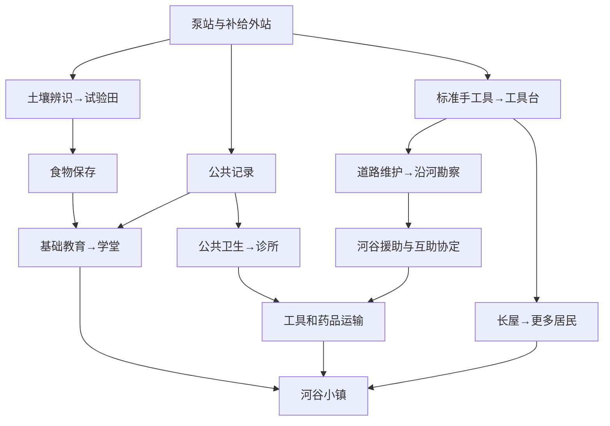

# 村镇阶段：当前实现规格

本文件记录已经接入运行代码的数值。真实游玩是否走到该节点，以08验证日志为准。全地球科技表中未列于此的节点仍属于后续规划。

## 发展依赖

初始维修间不展示这些功能。研究只在已掌握前置知识且满足实地发现条件后出现；完成的研究移出按钮列表，已掌握数量及悬停清单保留。建筑延续ADR原生建造列、材料悬停、资源门槛和温度要求。

## 资源与劳动

每10模拟秒先结算采集/农业，再分配居民口粮，再做需要原料的加工，随后扣外站维护与诊所治疗。居民口粮优先；加工不够一人的投入时，该人停工，不扣一半原料。派出的河谷车队单独每60秒结算。

| 岗位 | 上限 | 每人每10秒投入 | 正常产出 |
| --- | --- | --- | --- |
| 农夫 | 每块试验田4人 | 劳动、土地 | 食物1.4；灌溉且外站供给正常时2 |
| 制器工 | 工具台4人 | 废料0.6、木0.2 | 工具0.25 |
| 医护 | 诊所2人 | 食物0.2、废料0.1 | 基础药品0.15 |
| 教师 | 学堂2人 | 木0.1作为纸材 | 知识0.2 |

以上医护、教师是每座设施容量；机械传动后可付铁锭和零件扩建至两座，对应岗位各最多4人，首座成本不变。扩建数值和自然遇到的供药瓶颈见设计12。

配给、饥饿、低健康会影响产出。基础药品代表从食物原料和回收耗材配制的消毒/包扎用品，不代表已经恢复抗生素或先进制药。后续药物制备科技仍需要化工产业。

新增人口容量来自长屋，每座8床，最多4座；木屋仍最多4座、每座4床。河谷12居民属于独立聚居地，不暗中加入本地劳动力。当前迁入居民记录为成年年龄组；代际模块已经处理出生、成长、退休与寿终，儿童和退休居民吃饭但不进入岗位。个体适岗、毕业资格和职业履历仍未实现，具体代际规则见设计11。

## 健康与教育

健康初值80。人口达到12后，拥挤带来每10秒0.15的健康损失；缺粮时0.5。诊所至少有一名医护并支付每居民0.01药品时，改为恢复0.5，最高100。健康低于30时劳动产出乘0.75。人数少于12且无诊所时不启用这一层。健康显示在原有社会文字行，制度页不会提前出现。

教师占用实际劳动力和纸材，积累知识。当前知识为后续技术与组织研究的资源；尚无学校毕业/专业资格队列，不宣称居民已经接受个体培训。

## 第二个聚居地与运输

道路维护研究后，沿河勘察花12食物、4工具，180秒。河谷事件介绍12名居民及有角质变化的变异居民，明确他们有自己的生活、劳动和议事。保持距离仍记录路线，不永久关闭和平主线。

援助河谷花40食物、12工具，180秒；物资已经送到后，暂缓互助协定可以免费再谈，不重复收费。互助不等于吞并，居民不自动改国籍或迁到主聚落。

河谷道路花木160、废料30、工具10。盟友本地每10秒产粮3.2、12人吃1.44，净粮1.76；本地粮仓上限240。每60秒道路/外站正常、河谷至少24粮、本地具备所需物资时：

- 本地扣1工具、0.5药品，河谷库存收到同等物资。
- 河谷扣12粮，本地收到12粮。
- 运输另耗本地木1、旅粮2；掌握食物保存后旅粮降为1。
- 任一条件不满足整趟暂停，无免费粮、无负库存；补齐后下一轮自动恢复。

第一版运输不计独立驾驶员占岗；车队劳动包括在外站维护抽象中。后续物流科技会引入运力与运输岗位，不虚构当前已拥有完整货运系统。

## 小镇成立

本地至少20居民、诊所、学堂、健康至少60、三次成功往返且当前道路/外站正常、无饥饿、粮至少40、工具至少10，连续维持120模拟秒后，地点改为河谷小镇。期间缺一条件，稳定计时归零。小镇成立后才逐项出现四轴治理事件和议事屋，规则见设计11；地区整合仍待下一阶段实现。

## 与完整科技树的对应调整

土壤发现由修复泵站保证；诊疗手册来自交通站档案和公共记录，公共卫生无需等待随机来客。基础公共卫生可以配制基础药品，高级药物生产仍由medicine节点控制。已实现研究的成本与时长以`content/development.js`为唯一代码来源，完整依赖表应与之保持一致。

处理事件期间不消耗下一次随机事件的间隔，避免放置一阵后连着弹出琐事；研究、生产、路程仍走同一个模拟时钟。
