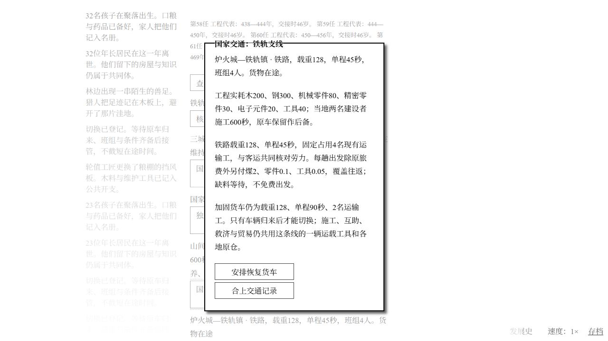

# Windows 国家铁路首段验收

2026-11-02，接续已推送的居留公约里程碑`999cace`和正常导出13。首段研究、实付施工、铁路接管、互助往返、后备货车切换与正常导入均已完成；完整地球篇仍未完成。

## 实现与范围

建国后研究铁路工程，使用已有钢、精密零件和电子元件。铁轨支线工程沿用公用工程的真实材料、回执、两名施工者与600秒实际工作；不生成新居民、库存或平行运单。完成后可排队接管原路线，等车辆归来再切换。铁路4名运输工、单程45秒、载重128，逐趟额外实付煤2、零件0.1、工具0.05；恢复货车为2人、90秒。施工、互助、贸易与救济仍共享原有运输。运行中的铁路缺班组会原地等待，缺燃料不能扣其他物资或免费发车。

## 规则与合成测试

- 铁路首轮7/7通过（111.8秒）；旧运输、财政、救济、地区图和队列89/89通过（15.4秒）。
- 补充班组不足时的排队/取消，以及伪造途中模式切换拒绝后，全量591/591通过（155.6秒），其中铁路8项。
- 铁路规则测试以13号的隔离副本开始，真实支付研究费，运行研究、真实运输建材与施工完成；不把副本算自然游玩。短缺用例明示临时改变测试煤或运输工，随后还原输入。
- 覆盖研究前置、付费工程、实际工作600秒、错误建造地点拒绝、旧档不新增空铁路对象、切换等待原车与劳力、45秒交付、燃料及维护扣款、欠料原子性、短班组停留、共同预算原车往返与旧账保存、救济退货只退货不退燃料、篡改记录拒绝。
- 全量后仅改善未能筹办铁路时的提示：具体指出国家共同法、加固货车或已有工程，不留下没有原因的缺失按钮。需在自然阶段重新载入并验证显示。

## 自然 UI 进度

- 14为铁路研究前的正常备份，随后重载新代码，经原生菜单原样导入。
- 正常进入科技，点击铁路工程，支付知识400、钢80、精密零件20、电子元件12；用已解锁16×完成研究，掌握技术29项。没有注入资源、人口或模拟时间。
- 研究期间正常选出第61任工程代表，国家认可暂低；持续恢复后在议事屋正常筹办工程，开工时刻275945。
- 15为276216秒、16×、第61任的正常导出，铁路技术已研究，公用工程13正在运材，尚未记录付款完工或施工秒数。SHA-256 `4166e4c7b3d71b7e6538ce5f8154b29c2c50ddb1429850492d4921b7b0cbea3b`；原生检查/替换及完整规则往返验证通过。
- 继续正常运输后，地方工程明细实际显示已到木200、钢56；没有提前写入完整材料或施工资产。第62任换届正常处理。尚未自然建成或启运，不以规则测试的成功替代。
- 随后正常处理第63任换届，工程282365秒实际竣工。原样16档记录两名施工者累计600秒，实际支付木200、钢300、零件80、精密零件30、电子元件20、工具40，共6张原车材料回执4219/4239/4258/4272/4291/4310。
- 282781秒在原生国家交通事件选择铁路接管，页面提示原车仍在途；282806秒等原车归来后实际接管。路线4名现有运输工、载重128、单程45秒，保留原仓与唯一运单。
- 16为283165秒、1×、国家认可73。互助订单`1:350:rail`在283114发车，实付药12、工具2.05、木1、粮1、零件0.15、煤2；283159真实到达（45秒），283160装好地方回程贡献，导出时仍在途。完整存档校验/编码解码与加载一致通过。SHA-256 `1c0c03e92d9647d3a66c195d960eac198f4df3a2582c42dd0748aa86088b7551`。
- 正常选择恢复货车，仍待这趟互助归来才执行；随后界面显示货车2人、90秒，并已开始正常发车。正在核对切回铁路、历史账册和最新导出。

## 最终接续检查点

17为283786秒、1×、第63任；本城1164、铁轨820、河谷1208，共3192。国家认可88.5，共同法正常。铁路首单283205完成返程，283206恢复货车，等货车完整往返后283396再次启用铁路；恢复请求实际提出于283368，当时仍有返程货物，未截短旅程。第二笔铁路互助283704出发、283749交付，导出时返程在途。

SHA-256：`2962d68ff6942e4f1bbeee96165cc2786030e5d16d4719906f4d9660d61c5bbc`。17完整规则校验、编码解码与加载一致通过；通过原生菜单重新粘贴、检查并替换成功，页面明确显示88.5认可、铁路4人/45秒、1×。

本切片仅为第一段真实货运铁路，仍共享原有贸易、互助、救济与工程运单。不是全国铁路网、八大区或地球统一完成。用户持续goal保持active，下一切片继续国家阶段，不暂停或声称全篇完成。
