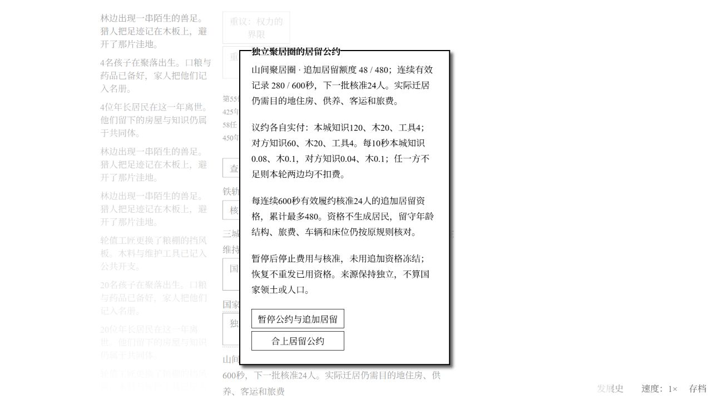

# Windows 建国后居留公约验收

2026-11-02，接续国家成立07、地方自治与换届恢复08的正常导出。完整地球篇仍未完成。

## 实现范围

国家成立后，议事屋逐步出现独立聚居圈公约。只使用已经联络的来源社会、独立仓库、年龄名册和原客运系统。双方真实支付建档与逐轮记录费用；连续600秒有效履约核准24人追加居留资格，累计最多480。资格不生成居民；迁居仍支付旅费、占用客车，并检查来源留守与目的地住房、供养。成文宪章下暂停/恢复公示60秒；暂停停止新费用和追加核准，冻结未用资格，保留既有名册与在途旅客。

## 合成与规则测试（不计作自然游玩）

- 以08的隔离副本运行真实模块和适配器；测试操作者处理换届、选择原生事件，住房由真实材料运输和施工获得。旧档不新增空公约对象，完整编码/解码不改变状态。
- 覆盖国家前置、双方签约实付、缺款不扣另一方、幂等、连续服务、资格上限、付费扩建、原客运扣款、暂停中的在途到达、来源总账、篡改拒绝。上限测试明确单独推进公约模块时钟并固定服务条件，不是自然记录或全系统长跑。
- 初轮全量583/583通过（125.8秒），随后追加自动发车结算边界断言，成功复现原实现失败。自动发车恰在10秒生产轮结束时，会遇到尚待核对的本轮记录，误以为公约失效。
- 修复后，本轮已实付时可沿用10秒内上一轮有效记录；本轮欠费立即失效，不能借旧记录出发。专项自动发车回归1/1通过（49.4秒），该修复后全量583/583通过（129.6秒）。
- 同查国家记录发现本轮欠付时也会短暂沿用上一轮服务，已用结算内部断言复现失败；修复为只有本轮各地实付才允许沿用。专项欠款回归1/1通过（8.3秒）；包含该补充修复的最终全量583/583通过（130.2秒）。
- 自然UI发现恢复公示期间仍先显示“已暂停”，调整状态文案优先显示正在公示；只改显示顺序，暂停/恢复专项1/1通过（10.6秒）。

## 正常 UI 游玩

- 从08经正常界面切换真实迁居来源为山间聚居圈、目的地铁轨镇。山间基础960人额度已耗尽；未重置基础协议。
- 09为签约前备份，铁轨第二片密集住区已用真实材料开工。
- 在议事屋正常签订山间居留公约，双方实付；签约本身额度仍为0。铁轨第二片密集住区在正常16×时间中建成，住房升至820。
- 10为签约、竣工和第58任交接后的正常导出。开发期间待处理换届使国家认可下降，正常选择工程代表后逐轮恢复。导出后重载新代码，通过原生存档检查/替换原样导入10；未补资源、人口或时间。
- 11为首批真实迁居后的正常导出：265980秒、1×。265422秒公约核准24人；265424秒原客车出发，p316实际扣除粮144、药4.8、工具5.3、木2、零件0.2，24人全部到达铁轨镇。来源累计迁入979人、途中死亡5人，恰为基础960加追加24；1600基线+9819出生=2000留守+8435来源死亡+5途中死亡+979迁入，总账相等。铁轨当前730人，包含原人口随时间的出生/死亡，不能把730与旧档的差额全算作迁居。
- 随后铁轨自然出生使粮食净供给转负；正常UI实付开工第二片水务田片，并将第三座药物制备所排入有限建设队列。供养恢复与后续重载验收继续进行。
- 12为270620秒、1×：两项供养工程均已完工，铁轨820人；公约累计48资格，实际第二批又有19人抵达，山间累计迁入998、途中死亡5，剩余追加资格5。暂停请求269666、公示生效269726；恢复请求269976，原定270036生效，因待办换届延后至270520实际生效。两次修订均保留在账册，暂停没有重新发放资格。自然待办曾使国家认可降至0，导出为5，需继续正常治理恢复。
- 12通过完整验证/往返一致，并在最新代码原生UI检查、替换成功。SHA-256：`b90516a128f0c4963bff9180e9a93ba9783f2e05534944e05beefa0f7b814f23`。

09—13均通过完整存档验证、编码/解码与加载前后状态一致检查。11的SHA-256为`d26e60ebd00917265cb0bc00a4c052bf4fccc0ae1fad5ede6fd817e5f245a72d`。

最终正常检查点13：272283秒、1×、第60任，本城1164、铁轨820、河谷1207，共3191人；国家认可46.75、共同法正常、国家协调+4。公约active、累计48资格、连续有效270秒；现有住房与粮药扩建均已完成。SHA-256为`e849578582a0cd2babfd8f6b07d99ecdf840cdf3cb3d6f9518909dfa4d312df2`。已在最新代码原生菜单重新粘贴、检查并替换13，页面显示46.75认可、48资格、铁轨820/820，与原始文件相符。

本里程碑只证明这份公约及建国后的治理/人口闭环；后续多伙伴外交、国家交通、军队与战争、宏观区整合、地球统一和首航仍未完成。用户仍要求持续自主迭代，未请求收工。
